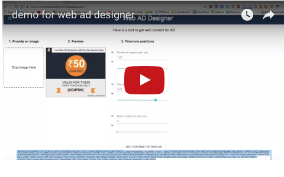

# Web AD Designer

A React-based web application for creating and customizing web advertisements with interactive elements. This tool allows users to upload images, add coupon codes, and define clickable areas to generate HTML content for web ads.

## 🚀 Live Demo

**Web App**: [https://cmwebaddesigner.firebaseapp.com](https://cmwebaddesigner.firebaseapp.com)

**Demo Video**: 
<a href="https://youtu.be/rzTtNR6qgmg" target="_blank">
    
</a>

## ✨ Features

- **Image Upload**: Drag and drop interface for uploading advertisement images
- **Coupon Code Overlay**: Add customizable coupon codes with precise positioning
- **Interactive Touch Areas**: Define clickable regions with adjustable top and bottom positions
- **Real-time Preview**: Live preview of your advertisement design
- **Fine-tuning Controls**: 
  - Slider controls for precise positioning
  - Button controls for pixel-perfect adjustments
  - Visual feedback with temporary highlighting of touch areas
- **HTML Generation**: Generate ready-to-use HTML content for web ads
- **Clipboard Integration**: Automatically copy generated HTML to clipboard

## 🛠️ Technology Stack

- **Frontend**: React 15.3.2
- **UI Framework**: Material-UI 0.15.4
- **File Upload**: React Dropzone 3.6.0
- **Build Tool**: React Scripts 0.6.1
- **Hosting**: Firebase Hosting

## 📋 Prerequisites

- Node.js (version compatible with React 15.3.2)
- npm or yarn package manager

## 🔧 Installation

1. Clone the repository:
```bash
git clone https://github.com/binghuan/WebAdDesigner.git
cd WebAdDesigner
```

2. Install dependencies:
```bash
npm install
```

3. Start the development server:
```bash
npm start
```

4. Open your browser and navigate to `http://localhost:3000`

## 📖 Usage

### Step 1: Upload Image
- Drag and drop an image file into the designated area
- The image will be automatically resized to 300x250 pixels for the ad preview

### Step 2: Preview Your Ad
- View the real-time preview of your advertisement
- See how the coupon code and clickable area will appear

### Step 3: Fine-tune Positions
- **Coupon Code Position**: Use sliders or arrow buttons to adjust the vertical position of the coupon text
- **Touch Area**: Define the clickable region by setting top and bottom boundaries
- **Visual Feedback**: Touch areas are temporarily highlighted in red when adjusted

### Step 4: Customize Content (Optional)
- **Coupon Text**: Modify the coupon code text (default: `{COUPON}`)
- **Link URL**: Set the destination URL for clicks (default: `{CLICK_URL}`)
- **Reset**: Use the reset button to restore default placeholder values

### Step 5: Generate HTML
- Click "Get content of web AD" to generate the HTML code
- The generated HTML is automatically copied to your clipboard
- The output area will briefly highlight in yellow to confirm generation

## 🎯 Default Settings

- **Ad Dimensions**: 300x250 pixels
- **Default Coupon Code**: `{COUPON}`
- **Default Click URL**: `{CLICK_URL}`
- **Touch Area Highlight Duration**: 2 seconds

## 🚀 Deployment

The application is configured for Firebase hosting:

```bash
npm run build
firebase deploy
```

## 📁 Project Structure

```
WebAdDesigner/
├── public/
│   ├── index.html
│   ├── icons/              # App icons in various sizes
│   └── images/             # Demo images and assets
├── src/
│   ├── App.js              # Main application component
│   ├── App.css             # Application styles
│   ├── index.js            # React DOM entry point
│   └── index.css           # Global styles
├── package.json            # Dependencies and scripts
├── firebase.json           # Firebase hosting configuration
└── README.md
```